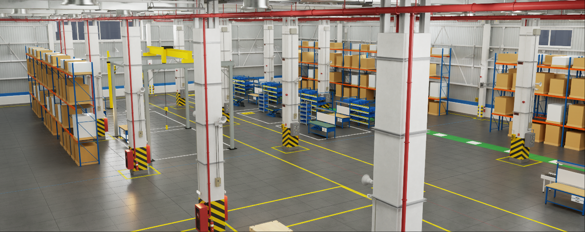

# Factory Review Toolkit

Build a realistic, reviewable factory scene in Omniverse from a plant layout drawing, in seconds instead of days, and
keep it in step when the drawing changes.



**Status: v0.1 (Phase 0 + start of Phase 1).**

| Area | What works |
|---|---|
| Drawings | DXF and PDF layout drawings are read and cleaned up. |
| Recognition | The building, column grid, doors and docks, aisles, walkways, stations and equipment are recognised. |
| Building | The real building is generated from NVIDIA's modular warehouse sections. |
| Equipment | Equipment is placed from a parametric catalog. |
| Review | The scene is validated and the findings are listed. |
| Revisions | A new drawing revision is compared and the scene is updated to it. |
| Packaging | The scene is packaged so it opens on another PC. |

Everything runs inside Kit (Window > Factory Review) and also from the command line without Kit.

## What it does

```
layout.dxf / layout.pdf ──► read + clean ──► interpret ──► recipe ──► build ──► scene.usd
                             units, dups,     outline, grid,  (TOML)    building    + scene.plant.json
                             gaps, strays     doors, aisles,            floor       + scene.findings.json
                                              stations, equip.          equipment
```

- **Drawings.** DXF reads units (`$INSUNITS`), far-away origins, duplicate lines, gaps and strays. Equipment comes
  from named blocks. PDF uses vector paths, reads the scale from "1:N" on the page, and takes equipment from labelled
  rectangles or circles.
- **Stations.** Rectangles named `STATION 3`, `STN 5`, `CELL 2`, `WS 4`, etc. become stations. The name can be inside
  the rectangle or written beside it. Each station gets white border lines and a yellow plate with its number painted
  on the floor.
- **Building.** NVIDIA Warehouse_A modules (walls, roof, columns, lights) are stretched to the drawing's real column
  grid. Dock and roll-up modules go where the drawing has docks and roll-up doors. Personnel door sets are added,
  because the pack has none.
- **Catalog.** Eleven items, each built at real size with real materials, a role tag and attachment points
  ([docs/catalog.png](docs/catalog.png)):
  - industrial table
  - scissor lift table
  - carton flow rack
  - belt / roller conveyor
  - selective pallet racking (single or back-to-back)
  - bin rack
  - pillar jib crane
  - freestanding bridge crane
  - pallet with boxes, crate and forklift (from the NVIDIA packs)
- **Review.** The validator checks:
  - units;
  - floating and sunk objects;
  - equipment overlaps (cranes are exempt);
  - implausible sizes;
  - missing assets and absolute asset paths.

  Findings carry a location and a camera view. Click **Go** to fly there.
- **Revisions.** Compare a new DXF or PDF with the built scene to see what was added, removed, moved or resized,
  then rebuild with **Update scene to it**.
- **Packaging.** Copies every layer, material and texture (UDIM tiles included) into one folder with relative paths.

## Install in Kit

1. Clone this repo, e.g. `C:\Users\you\Dev\factory-review-toolkit`.
2. Add `<repo>\exts` to the extension search paths:
   - in **Window > Extensions** (gear icon > Extension Search Paths), or
   - on the command line: `kit.exe your.app.kit --ext-folder <repo>\exts --enable frt.scene`.
3. Enable **frt.scene**. This also enables **frt.core**. On first load Kit installs `ezdxf`, `pymupdf`, `pyparsing`
   and `fonttools` from PyPI into the app's pip folder, which needs internet once.
4. Open **Window > Factory Review**.

The NVIDIA asset packs are expected under `C:\Nvidia_Assets` (Warehouse_NVD, Industrial_NVD). Set
`FRT_NVIDIA_ASSETS` if yours are elsewhere.

### The Factory Review window

| Section | Use |
|---|---|
| 1 Scene Builder | Pick a recipe, then **Build + open**. If the output scene is already open, it is closed, rebuilt and reopened (never overwritten in place). |
| 2 Review | **Validate open scene**: findings list with severity colours and **Go** buttons. |
| 3 Stations | Every station with its size; **Go** flies to it. |
| 4 New drawing revision | Path to the new DXF/PDF: **Compare with scene** lists the changes, **Update scene to it** rebuilds with it. |
| 5 Package | Copy the open scene and everything it uses into one folder for another PC. |

## Command line (no Kit)

Needs Python 3.11+ with `usd-core`, `numpy`, `ezdxf`, `pymupdf` (and `pillow`, `reportlab`, `pytest` for the tools
and tests).

```
python tools/frt.py build    samples/recipes/demo_plant.toml      build a scene from a recipe (+ validate)
python tools/frt.py drawing  plant.dxf|plant.pdf [legend.toml]     what the drawing says
python tools/frt.py diff     old.dxf|old.plant.json new.dxf|.pdf     what changed between two revisions
python tools/frt.py validate scene.usd [--auto-tag]                 check any scene
python tools/frt.py package  scene.usd out_dir                      portable folder
python tools/frt.py catalog                                         catalog items and their parameters
python tools/frt.py preview  scene.usd out.png [overview|plan]      quick offline picture
python -m pytest tests                                              46 tests
```

A command-line build refuses to replace a scene that Kit has open: the Kit extension leaves a `<scene>.open` marker.
Close the scene in Kit, or build from the window.

## Recipes

One small TOML file describes a scene. Change a line and rebuild.

```toml
[scene]
output = "../../out/demo_plant/demo_plant.usd"

[drawing]
file = "../drawings/demo_plant_revA.dxf"       # or .pdf; legend = "my_plant_legend.toml" for your CAD standard

[building]
generator = "warehouse_a"
height = "H10m"                                # or H450cm
wall_style = "mixed"                           # plain / windows / mixed

[equipment.defaults]                           # parameter defaults per catalog item
pallet_rack = { levels = 4, frame = "powder_blue", beam = "powder_orange" }

[[items]]                                      # extras not on the drawing (plant cm, x east, y north)
catalog = "industrial_table"
id = "QA1"
at = [2800, 2400]
params = { length = 240, top = "esd" }
```

## Your own drawings

How the interpreter recognises things is set by a legend file: layer names, block names, label words, the station
name pattern and the equipment tag pattern. Copy `exts/frt.core/frt_core/drawing/legend_default.toml`, adapt it to
your CAD standard and point the recipe at it.

`python tools/frt.py drawing your.dxf` lists what was found and what was not recognised (`?` lines).

## Layout

```
exts/frt.core/frt_core/    core library (pure Python + pxr; runs in Kit and outside)
  catalog/                 parametric equipment + pack assets
  drawing/                 DXF / PDF import, alignment, interpretation, legend
  building/warehouse_a.py  building generator
  recipe.py                recipe -> scene
  validate.py rules/       checks and rule packs (TOML)
  revision.py package.py usdio.py findings.py tags.py materials.py geom.py units.py
exts/frt.scene/            Kit UI: Window > Factory Review
samples/                   generic Demo Plant drawings (rev A/B, DXF + PDF) and recipe
tools/                     CLI, previews, sample drawing generator
tests/                     pytest
docs/                      architecture, Warehouse_A module notes, images
```

## Licence and assets

The toolkit code is the author's. The NVIDIA asset packs are not included and are not redistributable through this
repo. A packaged scene contains copies of pack files, so only share packages where the pack licence allows it.
